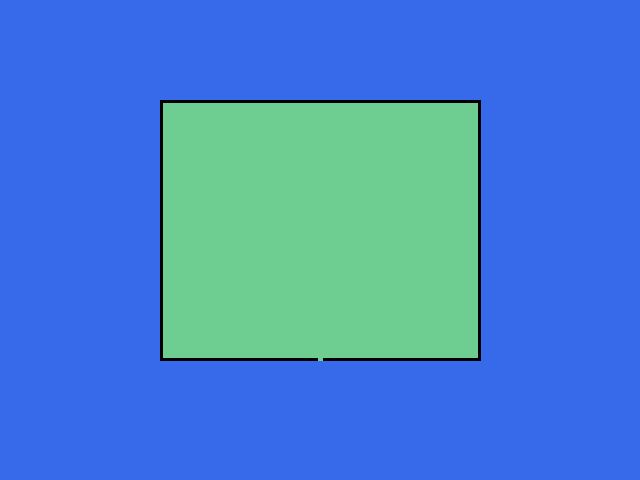
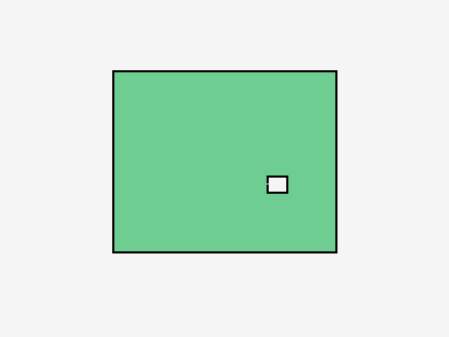
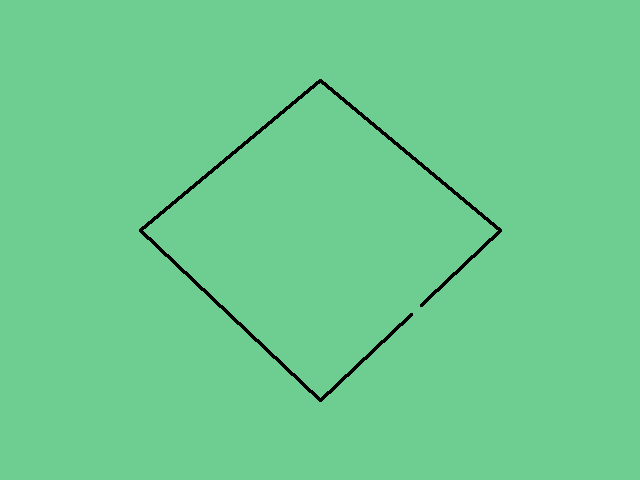
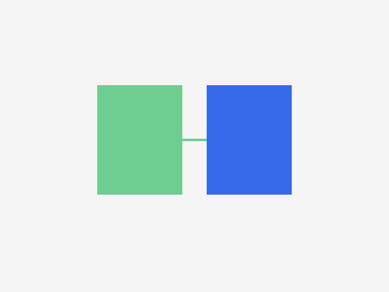

# Measured native and Croquis fill classification

These comparisons use successful captures from the pinned native CSP 5.1.4
ARM64 image and the exact source fixtures in
[fixtures/manifest.json](fixtures/manifest.json). Croquis's existing `fill.ts`
SHA256 for this run is
`d947273c2157bcdfd7539da1b3c3c87a9f32a80fc3cc36622f5477f3a780fe49`.
No product implementation was changed. The comparisons concern selection
classification, not final visible RGBA or anti-aliasing.

## Five-pixel rectangle opening, native gap 5

Capture:
[axis-gap-5-level3-20261013T140052.317600Z-c0d97ae4/fill.jsonl](evidence/captures/axis-gap-5-level3-20261013T140052.317600Z-c0d97ae4/fill.jsonl)

Report:
[comparison.json](evidence/captures/axis-gap-5-level3-20261013T140052.317600Z-c0d97ae4/comparison.json)

The document was opened from `axis-gap-5.png`: 640 × 480 pixels, 72 dpi,
viewed at 100%. The current-layer reference was selected; multiple reference
and area scaling were off, color margin was 10, anti-aliasing was on, and
Fill narrow areas was on. The third indicator box was selected. These UI
observations and source coordinates are retained in
[fixture-context.json](evidence/captures/axis-gap-5-level3-20261013T140052.317600Z-c0d97ae4/fixture-context.json).

The native capture independently confirms raw gap width **5**, narrow-area
flag **1024**, bitmap dimensions **640 × 480**, document offset **[0, 0]**,
and seed **[320, 230]**, exactly matching the fixture. Entry, initial, and
return boundaries were captured completely, and native return succeeded.

| Measurement               | Native A             | Existing Croquis at raw gap 5 |
| ------------------------- | -------------------- | ----------------------------- |
| Selected pixels           | 80,340               | 303,759                       |
| Exclusive selected bounds | [163, 103, 478, 361] | [0, 0, 640, 480]              |
| Interior probe [320, 230] | Selected             | Selected                      |
| Exterior probe [320, 420] | Omitted              | Selected                      |
| Opening probe [320, 359]  | Selected             | Selected                      |
| Canvas sides reached      | None                 | All four                      |

Native-only selection is **0 pixels**; Croquis-only selection is **223,419
pixels**, covering the exterior. Neither selection includes a pixel that is
ineligible under the exact binary-alpha source fixture. This establishes a
substantial gap-closing classification difference at the same raw gap value.

The native A mask has **0** selected bits at entry, **77,500** after the initial
flood, and **80,340** at return. Its initial bounds are [166, 106, 476, 356].
The change agrees with the statically recovered initial-barrier and restoration
stages; it does not by itself prove a complete reproduction of those stages.

Final C contains **244,239 positive eligible bits**, **0 positive ineligible
bits**, and **59,520 eligible source pixels with zero captured C bits**. C's
lazy preparation means those zeros do not prove a native eligibility rejection.

The final returned rectangle is [163, 103, 478, 360]. Assuming the recovered
exclusive right/bottom convention, **five selected A pixels** at
[318, 360, 323, 361] fall beyond that rectangle. The report records these
separately and preserves the complete A mask. It does not crop those bits or
claim that every selected A bit becomes an identical visible pixel afterward.

The full source fixtures, decoder safeguards, baseline reproduction commands,
and comparison method are described in [FIXTURES.md](FIXTURES.md).

## Small enclosed pocket, native gap 5

Capture and report:
[narrow-pocket-level3-20261013T141408.136413Z-386e70b1/comparison.json](evidence/captures/narrow-pocket-level3-20261013T141408.136413Z-386e70b1/comparison.json)

The native seed was **[322, 176]**, rather than the fixture default [320, 230].
It is a transparent source pixel inside the intended main room, outside the
small pocket. The comparison explicitly used `--use-captured-seed` to recompute
Croquis at [322, 176]. The native capture confirms gap **5**, narrow-area flag
**1024**, dimensions **640 × 480**, offset **[0, 0]**, successful return, and
complete boundary bytes. The operator observed the source unchanged before
the fill and a red main room with a transparent pocket afterward. The native
reference, color-margin, anti-aliasing, and area-scaling settings were the same
as the first comparison.

| Measurement                | Native A             | Croquis at the captured seed |
| -------------------------- | -------------------- | ---------------------------- |
| Selected pixels            | 79,525               | 79,523                       |
| Exclusive selected bounds  | [163, 103, 478, 358] | [163, 103, 478, 358]         |
| Main-room probe [320, 230] | Selected             | Selected                     |
| Pocket probe [395, 262]    | Omitted              | Omitted                      |
| Exterior probe [320, 420]  | Omitted              | Omitted                      |

Native-only selection consists of exactly **two pixels**, **[382, 261]** and
**[382, 262]**, at the pocket end of its passage. Croquis-only selection is
zero. Neither algorithm selects a known ineligible source pixel, and native A
has no selected bits beyond the returned exclusive rectangle. Final C has
243,924 positive eligible bits, zero positive ineligible bits, and 59,520
eligible zeros that may be unprepared.

This demonstrates a small boundary-classification difference, while both
implementations agree that the pocket itself stays omitted at gap 5. It does
not test the larger native omitted-component limit at gap 10.

## Diagonal opening, native gap 5

Capture and report:
[diagonal-opening-level3-20261013T141610.573151Z-6bcdba24/comparison.json](evidence/captures/diagonal-opening-level3-20261013T141610.573151Z-6bcdba24/comparison.json)

The native seed was **[318, 176]**, a transparent source pixel inside the
diamond, rather than the default [320, 230]. Croquis was explicitly recomputed
at [318, 176]. The native capture again confirms gap **5**, narrow-area flag
**1024**, dimensions **640 × 480**, offset **[0, 0]**, successful return, and
complete boundary bytes under the same native tool settings.

The final selection masks are **exactly identical** on the document: **303,803
pixels** each, bounds [0, 0, 640, 480], with the interior, opening, and exterior
probes all selected and all four canvas sides reached. Native-only and
Croquis-only differences are both zero. Neither selects a known ineligible
pixel; native A has no bits outside the document or returned rectangle.

Unlike the earlier lazily prepared C captures, this final C matches the entire
known source eligibility mask: all 303,803 eligible pixels are positive, with
zero positive ineligible pixels and zero eligible zeros. The exact agreement
is specific to this fixture, gap, seed, and narrow-area setting; it does not
establish general native equivalence.

## Opaque green recolor through a four-pixel bridge, native gap 5

Capture and report:
[recolor-bridge-4-level3-20261013T141912.452861Z-d86e43c3/comparison.json](evidence/captures/recolor-bridge-4-level3-20261013T141912.452861Z-d86e43c3/comparison.json)

The document was opened from the original `recolor-bridge-4.png`. The operator
cancelled an incidental merged filter and undid its layer addition before the
capture, then verified that the original green dumbbell was displayed. The
native seed was **[254, 246]**, inside the original left lobe; its exact source
RGBA is **[0, 180, 0, 255]**. The view was rotated 90 degrees for an
accessibility window click; the source pixels were not replaced by a new
fixture. Croquis was explicitly recomputed at the captured document seed,
instead of the default [230, 230]. The native gap remained **5**, narrow-area
flag **1024**, bitmap dimensions **640 × 480**, and document offset **[0, 0]**,
under the same native tool settings. Native return and all boundary-byte
captures succeeded.

| Measurement                 | Native A             | Croquis at the captured seed |
| --------------------------- | -------------------- | ---------------------------- |
| Selected pixels             | 25,360               | 50,560                       |
| Exclusive selected bounds   | [160, 140, 340, 320] | [160, 140, 480, 320]         |
| Left-lobe probe [230, 230]  | Selected             | Selected                     |
| Bridge probe [320, 230]     | Selected             | Selected                     |
| Right-lobe probe [410, 230] | Omitted              | Selected                     |
| Exterior probe [320, 420]   | Omitted              | Omitted                      |

Native selects the **25,200-pixel left lobe** and the **160-pixel bridge**.
Croquis selects those and the **25,200-pixel right lobe**. Native-only selection
is zero; Croquis-only selection is exactly the complete right lobe, bounds
[340, 140, 480, 320]. Neither algorithm selects a known ineligible source
pixel, and native A has no selected bits outside the document.

Final C exactly matches the entire known eligibility mask: all **50,560 green
pixels** are positive, no ineligible pixels are positive, and no eligible
pixels are zero. The right-lobe omission is therefore a fill-processing
difference, not a candidate-color disagreement. Croquis explicitly disables
gap closing for recolors; this native operation still separates the lobes
through the narrow bridge at gap 5.

Native A retains **four bridge-end pixels** at [339, 228, 340, 232] beyond the
returned rectangle's exclusive right edge. Those bits are preserved and
reported separately, as in the first rectangle comparison. This result still
concerns native A classification rather than the final rendered RGBA.

