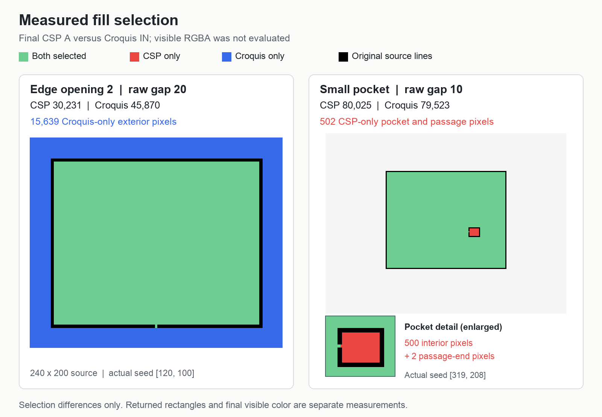
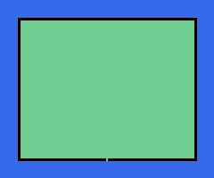
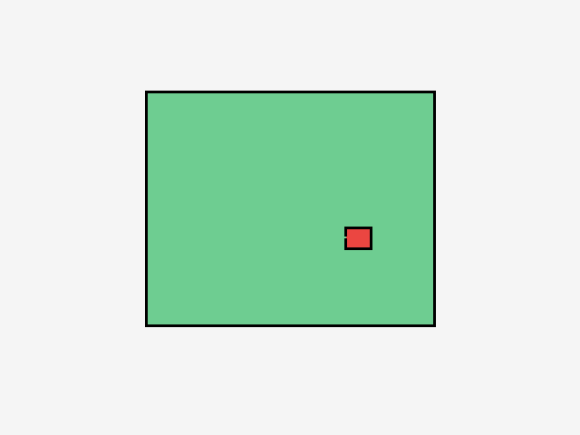

# Larger-gap native and Croquis classification

This extends the four raw-gap-5 observations in [COMPARISONS.md](COMPARISONS.md)
using the original exact binary-alpha source fixtures. It compares complete
final native A with Croquis `IN`, preserving both complete masks and both
directions of difference. Visible RGBA, anti-aliasing, and the native returned
rectangle remain separate measurements. No product implementation was changed.

The planned ten-case matrix, per-capture settings, recorded Croquis probes,
and original input hashes are in
[matrix.json](evidence/larger-gap-matrix-20261013/matrix.json) and
[source-controls.json](evidence/larger-gap-matrix-20261013/source-controls.json).
The [verified result index](evidence/larger-gap-matrix-20261013/verified-results.json)
records every completed call, its capture/report hashes, and the three
uncaptured cases separately.
Preparation read all 11 original PNGs and compressed RGBA files without writing
them. PNG and decompressed RGBA hashes matched the original manifest; a second
check confirmed those inputs, their compressed files, the manifest, and the
55-case Croquis baseline file were unchanged. Existing Croquis `fill.ts` SHA256
remains `d947273c2157bcdfd7539da1b3c3c87a9f32a80fc3cc36622f5477f3a780fe49`.

## Completed native comparisons

Seven of the ten planned calls produced complete successful native captures.
All used Fill narrow areas on, captured flag 1024, and original binary-alpha
sources. Counts below concern final native A versus Croquis `IN` at the actual
captured seed.

| Fixture         | Raw gap | Actual seed | Native A | Croquis IN | Native-only | Croquis-only |
| --------------- | ------- | ----------- | -------- | ---------- | ----------- | ------------ |
| Edge opening 2  | 10      | [120, 100]  | 30,231   | 30,229     | 2           | 0            |
| Edge opening 2  | 20      | [120, 100]  | 30,231   | 45,870     | 0           | 15,639       |
| Axis opening 10 | 10      | [320, 230]  | 80,355   | 80,345     | 10          | 0            |
| Axis opening 20 | 10      | [320, 230]  | 303,804  | 303,804    | 0           | 0            |
| Axis opening 20 | 20      | [320, 230]  | 80,406   | 80,365     | 41          | 0            |
| Axis opening 21 | 20      | [320, 230]  | 303,807  | 303,807    | 0           | 0            |
| Small pocket    | 10      | [319, 208]  | 80,025   | 79,523     | 502         | 0            |

The two material differences are the edge fixture at gap 20, where Croquis
selects exterior pixels that native omits, and the pocket at gap 10, where
native selects the pocket that Croquis omits. The other unequal masks differ
at the opening boundary. Exact enclosure agreement in the two axis controls
does not establish complete algorithm equivalence.

The graphic is generated from the complete measured selection masks, with
nearest-neighbor display scaling. Its [source metadata](evidence/larger-gap-matrix-20261013/measured-mask-comparison.json)
retains both report hashes, capture hashes, actual seeds, and source hashes.
The pocket detail is a labeled display crop; no selection data was cropped
from the reports.

## Exact 240 × 200 edge case at native gaps 10 and 20

Capture:
[fill.jsonl](evidence/captures/edge-gap-2-large-pair-20261013T155604.899989Z-d29399af/fill.jsonl)

Complete report:
[larger-gap-comparison.json](evidence/captures/edge-gap-2-large-pair-20261013T155604.899989Z-d29399af/larger-gap-comparison.json)

The original `edge-gap-2.png` has a three-pixel black rectangle with a
two-column bottom opening, twenty pixels from the physical canvas sides.
The operator filled it in red, undid that fill, then filled the original
source again. The reference was the current editing layer, multiple reference
and area scaling were off, color margin was 10, and anti-aliasing and Fill
narrow areas were on. The two planned calls are recorded in
[pair metadata](evidence/larger-gap-matrix-20261013/edge-gap-2-pair-metadata.json).

Each native boundary independently confirms its raw gap: **10** for call 1,
**20** for call 2. Both confirm narrow-area flag **1024**, exact document seed
**[120, 100]**, bitmap dimensions **240 × 200**, offset **[0, 0]**, complete
snapshots, and successful return. The recorder reported clean observed detach;
the launcher independently verified the same research executable had resumed.

| Measurement               | Native gap 10      | Croquis gap 10     | Native gap 20      | Croquis gap 20   |
| ------------------------- | ------------------ | ------------------ | ------------------ | ---------------- |
| Selected pixels           | 30,231             | 30,229             | 30,231             | 45,870           |
| Exclusive selected bounds | [23, 23, 218, 181] | [23, 23, 218, 180] | [23, 23, 218, 181] | [0, 0, 240, 200] |
| Interior [120, 100]       | Selected           | Selected           | Selected           | Selected         |
| Exterior [120, 190]       | Omitted            | Omitted            | Omitted            | Selected         |
| Opening [120, 179]        | Selected           | Selected           | Selected           | Selected         |
| Canvas sides reached      | None               | None               | None               | All four         |
| Native-only pixels        | 2                  | —                  | 0                  | —                |
| Croquis-only pixels       | 0                  | —                  | 15,639             | —                |

The native final A masks at gaps 10 and 20 are byte-for-byte identical after
lossless decoding. At gap 10, native-only pixels are exactly **[119, 180]**
and **[120, 180]**, the final row of the opening. At gap 20, Croquis selects
**15,639** additional exterior pixels and reaches every canvas side. Native
keeps the same enclosure as at gap 10. This directly establishes the edge-case
classification difference at the larger setting.

The initial native A differs between settings: gap 10 selects **26,825**
pixels in [28, 28, 213, 173], while gap 20 selects **23,625** in
[33, 33, 208, 168]. Both start with zero selected entry bits and finish with
30,231 bits. Those initial/final changes are observations; they do not prove
which individual restoration or recovery pass accounts for every pixel.

Final C matches the entire known source eligibility mask in both calls:
**45,870 positive eligible bits**, zero positive ineligible bits, and zero
eligible zero bits. Neither selection contains a known ineligible pixel or a
selected pixel outside the source document.

Both native calls return rectangle **[23, 23, 218, 180]**. The same two final
A bits at [119, 180, 121, 181] lie below that rectangle under the recovered
exclusive-bound convention. They remain in the full selection comparison;
the report does not infer their final visible RGBA.

## Ten-column opening at native gap 10

Capture and complete report:
[larger-gap-comparison.json](evidence/captures/axis-gap-10-large-20261013T155814.143007Z-6da2f0b2/larger-gap-comparison.json)

The original `axis-gap-10.png` was filled under the same tool settings. Native
confirms raw gap **10**, narrow-area flag **1024**, exact seed **[320, 230]**,
dimensions **640 × 480**, offset **[0, 0]**, and a complete successful return.

Both algorithms close the ten-column opening: the interior and opening probes
are selected, the exterior [320, 420] is omitted, and neither reaches a canvas
side. Native selects **80,355** pixels in [163, 103, 478, 361]; Croquis selects
**80,345** in [163, 103, 478, 360]. The difference consists of exactly **ten
native-only pixels**, [315, 360, 325, 361], in the bottom row of the opening.
Croquis-only selection is zero. Those same ten A bits lie below the returned
rectangle [163, 103, 478, 360]; they are retained without inferring visible RGBA.

Native starts with zero A bits, selects **74,725** after the initial flood
in [168, 108, 473, 353], and finishes with 80,355. Final C has **245,694**
positive eligible bits, zero positive ineligible bits, and **58,080** eligible
zero bits that may be unprepared. Neither final selection includes a known
ineligible pixel or a pixel outside the document.

## Twenty-column opening at native gaps 10 and 20

Capture and complete report:
[larger-gap-comparison.json](evidence/captures/axis-gap-20-large-pair-20261013T160048.217620Z-d80c6363/larger-gap-comparison.json)

Both calls use the original `axis-gap-20.png`, with Undo between them, and the
same native tool settings. Captured raw gaps are **10** then **20**, with
exact seed **[320, 230]**, dimensions **640 × 480**, offset **[0, 0]**,
narrow-area flag **1024**, complete snapshots, and successful returns.

At gap **10**, native and Croquis masks are **exactly identical**: **303,804**
selected pixels, bounds [0, 0, 640, 480], exterior selected, and all four canvas
sides reached. Native initial A has 292,354 bits. Final C exactly matches all
303,804 known eligible source pixels, with no positive ineligible bits or
eligible zeros. No selected bits lie outside the native returned rectangle.

At gap **20**, both algorithms enclose the fill and omit the exterior probe.
Native selects **80,406** pixels in [163, 103, 478, 362]; Croquis selects
**80,365** in [163, 103, 478, 360]. Native-only selection is **41** pixels in
[309, 360, 330, 362], adjoining the bottom opening; Croquis-only is zero.
Of those bits, **21** on row 361 lie below the returned rectangle
[163, 103, 478, 361]. The complete A mask retains them. Native initial A has
69,325 pixels in [173, 113, 468, 348]. Final C has 248,124 positive eligible
bits, zero positive ineligible bits, and 55,680 eligible zeros that may be
unprepared. Neither algorithm selects a known ineligible pixel or a pixel
outside the source document.

This pair directly tests a twenty-column opening below and at the corresponding
raw gap width. Enclosure agrees in those two cases, while the selected opening
boundary differs at gap 20. It does not establish a general threshold rule.

## Twenty-one-column opening at native gap 20

Capture and complete report:
[larger-gap-comparison.json](evidence/captures/axis-gap-21-largest-20261013T160308.199177Z-e4d6d76d/larger-gap-comparison.json)

The original `axis-gap-21.png` was filled at captured raw gap **20**, exact
seed **[320, 230]**, narrow-area flag **1024**, dimensions **640 × 480**,
and offset **[0, 0]**, under the same tool settings. Every boundary snapshot
is complete and native return succeeds.

The final native and Croquis masks are **exactly identical**: **303,807**
pixels, bounds [0, 0, 640, 480], all three probes selected, and all four canvas
sides reached. Native initial A has 280,727 pixels; entry A is empty. Final C
exactly matches all 303,807 eligible source pixels, with zero positive
ineligible bits and zero eligible zeros. No selected bits lie outside the
source document or the returned rectangle [0, 0, 640, 480].

Alongside the twenty-column case at gap 20, this establishes the measured
enclosed/open transition for these specific axis-aligned source outlines.

## Small pocket at native gap 10

Capture and complete report:
[larger-gap-comparison.json](evidence/captures/narrow-pocket-large-ax-g10-20261013T162344.627766Z-0bbe8c28/larger-gap-comparison.json)

Point-based input failed during the preceding attempts. The operator hid the
palettes and used an accessibility window-center click after visually verifying
the original outline and clear pocket following Undo. The on-disk PNG and RGBA
remain the original controlled source; their hashes do not by themselves prove
the application's full in-memory RGBA, which was not captured independently.
The actual native document seed is **[319, 208]**, a transparent main-room
source pixel, rather than the fixture default [320, 230]. The comparison
explicitly uses `--use-captured-seed` to recompute Croquis at [319, 208].

Native independently confirms raw gap **10**, narrow-area flag **1024**,
dimensions **640 × 480**, offset **[0, 0]**, complete boundaries, and successful
return. The same reference, color-margin, anti-aliasing, and area-scaling
settings were retained. The launcher verifies clean detach and independent
process resume.

Native selects the full **80,025-pixel** source room component, including the
pocket. Croquis selects **79,523** pixels and omits the pocket. Both have bounds
[163, 103, 478, 358], select the main-room probe, omit the exterior probe, and
reach no canvas side. Native-only selection is **502 pixels**: every one of
the **500** pocket-interior pixels in [383, 253, 408, 273], plus passage-end
pixels **[382, 261]** and **[382, 262]**. Croquis-only selection is zero.

An independent four-neighbor flood of the original transparent source pixels
at [319, 208] also exactly matches the complete native mask, with zero pixel
differences.

The earlier native gap-5 capture omitted the 500-pixel pocket interior while
retaining those two passage-end pixels. This new gap-10 result is consistent
with the recovered common omitted-component limit growing from **200** to
**800** pixels. The final capture does not isolate that recovery pass or prove
the exact acceptance threshold by itself.

Native A starts empty, reaches 73,249 pixels after the initial flood in
[168, 108, 473, 353], and finishes at 80,025. Final C contains 245,364 positive
eligible bits, zero positive ineligible bits, and 58,080 eligible zeros that
may be unprepared. Neither final selection contains a known ineligible pixel
or a selected pixel outside the source document. Native A has no selected
bits outside its returned rectangle [163, 103, 478, 358].

## Uncaptured cases

Three planned cases have **no native selected-mask evidence**: small pocket
at gap **20**, and the actual near-line seed at gaps **10** and **20**. Point
input became unavailable (`noWindowsAvailable`) even outside a debugger
attachment. Fresh app selection and reset did not recover it. The accessibility
window-center fallback obtained the pocket gap-10 capture above, but it did
not provide controlled input for the three remaining cases. Scroll input also
failed, and the targeted 23% zoom preset was unavailable.

The fixture's intended near-line seed is [320, 103], adjacent to the upper
outline. An ordinary main-room seed does not test that condition and has not
been relabeled as near-line evidence. Original Croquis baselines exist for all
three uncaptured cases, but they cannot substitute for native measurements.
Further native experiments were deferred until controlled point input can be
recovered; the completed comparison matrix above has seven calls, not ten.

## Failed input attempts retained separately

Two planned pocket-pair attempts did not enter native fill. Both retain their
original recorder snapshots, raw JSONL, launcher metadata, and failure output:

- [First attempt](evidence/captures/narrow-pocket-large-pair-20261013T160531.815206Z-1e0f0899/launcher-result.json)
  ended with `CaptureError: capture_deadline_reached`, **zero entries**, zero
  pairs, and no observed fill operation. Its initial independent resume check
  failed; [explicit resume recovery](evidence/captures/narrow-pocket-large-pair-20261013T160531.815206Z-1e0f0899/explicit-resume-recovery.json)
  is preserved separately.
- [Retry](evidence/captures/narrow-pocket-large-pair-retry-20261013T160950.408112Z-0ae66765/launcher-result.json)
  ended with the same capture-deadline error and **zero entries** or pairs.
  Its launcher independently verified the process resumed.

Neither attempt produced a native selected mask, so neither supplies algorithm
or latency evidence and neither is counted as a successful comparison. The
successful edge/axis captures above retain their own complete boundaries,
successful returns, clean detach, and independent resume evidence.

## Appendix: diagonal opening at native gap 10

This additional control is outside the original ten-case matrix.

Capture and complete report:
[larger-gap-comparison.json](evidence/captures/diagonal-opening-g10-20261013T164101.307653Z-3826f25c/larger-gap-comparison.json)

The document was opened fresh from the original `diagonal-opening.png`. With
palettes hidden, an accessibility window-center click yielded actual native
seed **[319, 208]**, a transparent source pixel inside the diamond, rather
than default [320, 230]. Croquis was explicitly recomputed at that captured
seed. Native confirms gap **10**, flag **1024**, dimensions **640 × 480**,
offset **[0, 0]**, complete boundaries, and successful return under the same
reference, color-margin, anti-aliasing, and area-scaling settings. Clean detach
and independent resume are retained in the launcher result.

Both algorithms enclose the fill, select the interior and opening probes,
omit exterior [540, 420], and reach no canvas side. Both have exclusive
bounds **[143, 83, 498, 398]**. Native selects **55,966** pixels; Croquis
selects **55,919**. The **47 native-only pixels** lie around the opening
in **[413, 307, 422, 315]**; Croquis-only selection is zero. Neither algorithm
selects a known ineligible pixel or a pixel outside the document, and native
A has no selected bits outside the returned rectangle.

Native starts empty, selects **49,452** initial pixels in
[154, 92, 487, 388], and finishes with 55,966. Final C has **245,723** positive
eligible bits, zero positive ineligible bits, and **58,080** eligible zeros
that may be unprepared. At the earlier native gap 5, this source's interior
and exterior were both selected and native agreed exactly with Croquis.
The new gap-10 result tests enclosure with a diagonal opening while retaining
the localized boundary difference.

## Verification

`validate_fixtures.py` confirmed all 11 sources' PNG checksums, exact decoded
RGBA, binary alpha, dimensions, and hashes. All seven existing bitmap and
comparison tests passed. The original matrix's seven completed calls and the
additional diagonal control produce **eight complete successful comparisons**,
with no rejected calls or comparison failures. Each full report retains the
capture SHA256 and lossless selection/difference masks. Final checks again
confirm that the 11 original PNG/gzip/RGBA sources, manifest, 55-case baseline
file, and product fill implementation are unchanged. The measured figure's
PNG hash and source metadata also verify.

The final result-index check verifies all six successful raw capture-file
hashes, each call's complete entry/initial/return boundaries, every decoded
selection count, and both lossless difference masks for all eight comparisons.
