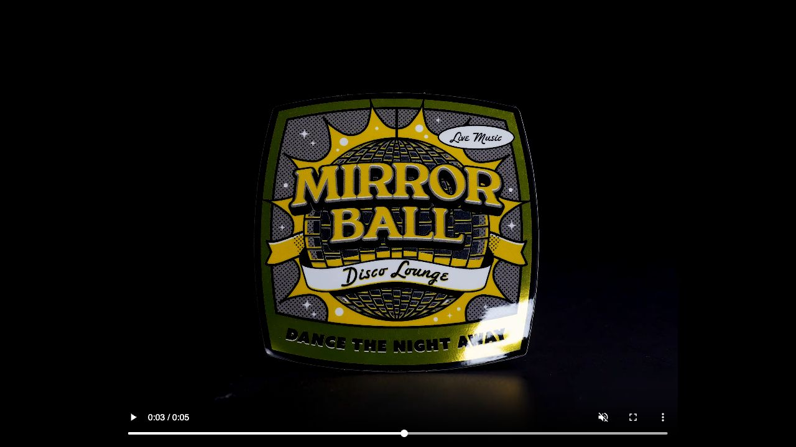
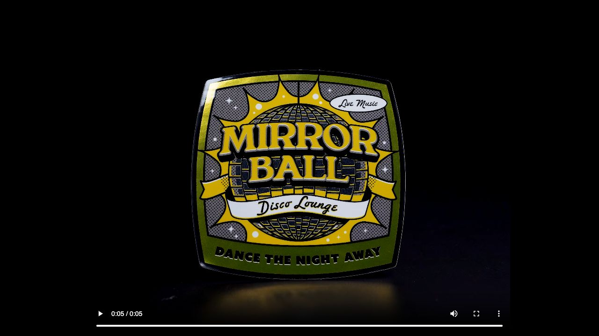
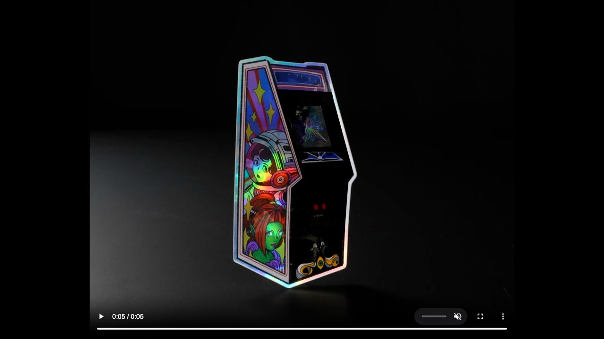
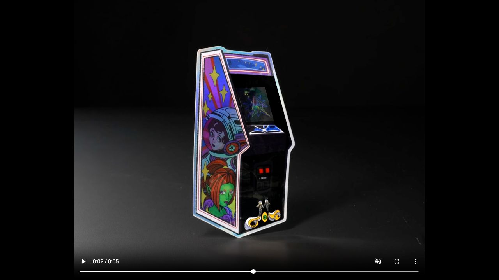

# Sticker foil research and proposed direction

Research date: October 13, 2026. This document records evidence and approaches considered. The selected proposal is in the [sticker foil design](../../superpowers/specs/2026-10-13-sticker-foil-design.md), pending written-spec approval. No product behavior changed during this investigation.

## Intended result

Croquis should make a sticker feel like a physical object when the phone moves. The existing laminate and overlap creases establish the quality target. Foil should respond to that same light and surface shape, with convincing changes across the material rather than a fixed strip translated over it. Artwork remains primary, and the existing meanings of holo, pink foil, and Kyoto Seika Practice Mode foil remain intact.

Success means fixed print, convincing reflective dark and bright states, reflections that bend at creases, consistent response through sticker turns and lifts, and a repeatable appearance when the phone returns to the same orientation. Material motion must continue to use the existing shared orientation input, including its reduced-motion and unavailable-sensor behavior.

## What real stickers establish

### A sticker has distinct optical layers

Sticker it publishes an actual holographic sticker cross-section: a 20 µm clear gloss polypropylene laminate above printed ink and white ink, a 40 µm metallized holographic polypropylene layer, adhesive, and backing paper. Those dimensions describe one product. The useful general lesson is that protective gloss, printed artwork, and reflective substrate are separate layers.

Source: https://v3-media.stickerit.co/64227/1655846725-holographic-material-datasheet.pdf

StickerApp explains that its silver mirror and brushed aluminum materials can produce colored metal through CMYK printing. A smooth mirror surface and a brushed surface have different reflection shapes. StickerGiant explains that an opaque white underprint blocks specialty substrate effects, while semitransparent color allows the substrate to influence appearance. These support fixed dark ink over exposed reflective gaps for Kyoto Seika Practice Mode foil.

Sources:

- https://stickerapp.com/blog/sticker-academy/how-to-make-metallic-stickers
- https://stickerapp.com/stickers/materials/mirror-stickers
- https://support.stickergiant.com/hc/en-us/articles/39016760860820-What-is-a-White-Layer

Measurements of ink on metallic substrate also distinguish inked and uninked scattering, transmission through ink, and possible relief from deposited ink. Their particular printer and halftone frequencies are not Croquis parameters. At the app's narrow foil widths, fixed ink coverage over metal is a defensible initial approximation; dot-shaped surface bumps are not established by the sticker references.

Source: https://library.imaging.org/admin/apis/public/api/ist/website/downloadArticle/cic/21/1/art00011

### Metal, holographic foil, and thin-film color differ

Metal's dominant cue is reflected surroundings. Smooth metal can become bright silver where it reflects a source and dark gray where it reflects a darker region. A rough conductor model accounts for unresolved surface variation; visible overlap creases belong in the geometric normal instead. A dielectric gloss highlight over flat gray does not supply the underlying metal response.

Sources:

- https://www.pbr-book.org/4ed/Reflection_Models/Conductor_BRDF
- https://www.pbr-book.org/4ed/Reflection_Models/Roughness_Using_Microfacet_Theory

Decorative holographic foil adds microscopic grooves that send wavelengths into different directions. ITW describes optical mastering and microembossing, with overprinting supported. Zero order has the ordinary specular direction; higher orders separate wavelengths. Each order's efficiency depends on the construction, and zero order can be suppressed. Groove spacing, orientation, profile, light direction, and view direction determine the response. The grating equation determines an order's direction, not how much energy it receives.

Sources:

- https://www.itwshinemark.com/hs-fs/hub/167113/file-18395637-pdf/images/primers/itw_foils_custom_registered_holography.pdf
- https://www.newport.com/t/grating-physics/f/plane-holographic-reflection-gratings/

Thin-film interference instead depends on optical layer thickness and refractive indices. The familiar oil-film or soap-bubble model does not describe the lateral grooves of decorative holographic foil. An ordinary protective laminate does not establish that an interference coating is present.

Sources:

- https://belcour.github.io/blog/research/publication/2017/05/01/brdf-thin-film.html
- https://github.com/KhronosGroup/glTF/blob/main/extensions/2.0/Khronos/KHR_materials_iridescence/README.md

Pink color alone also does not establish a mechanism: vendors sell both pink mirror and pink holographic vinyl. Foilco documents another relevant construction, dyed translucent lacquer over metallized aluminum, though its hot-stamping process is not the exact sticker construction above. Croquis already gives pink foil a restricted colored response; the proposal preserves that distinction rather than changing its meaning.

Sources:

- https://teckwrapcraft.com/collections/bubble-free
- https://teckwrapcraft.com/products/bubble-free-holographic-glossy-rainbow-adhesive-vinyl
- https://www.foilco.com/structure-of-foil/

## Inspected motion references

The following are browser screenshots of official StickerApp motion demonstrations. Printed marks and silhouettes remain essentially fixed while reflected appearance changes. The vendor does not identify their filming or rendering method, and no measured tilt is supplied. They establish useful appearance targets, not a calibrated phone-angle response. Remote video files were not downloaded.

### Mirror material with black halftone print

At 3.016878 s, broad glare crosses the lower-right area. At 5.896 s, glare is near the upper-left edge. The black halftone panels remain anchored over silver/gray regions. The metallic border is darker away from glare, and no rainbow is visible in these frames. This is the closest visual reference for Kyoto Seika Practice Mode foil.





Page: https://stickerapp.com/stickers/materials/mirror-stickers

Motion asset: https://stickerapp.com/media/x/a7c007623e/material_carousel_clip_mirror.webm

### Holographic printed material

At 5.533 s, localized cyan/green/yellow/orange reflection is vivid over the helmet and background. At 2.831137 s, much of that response recedes and the printed art appears more plainly. Dark printed regions suppress much of the effect. The material does not remain a uniformly saturated rainbow.





Page: https://stickerapp.com/stickers/materials/holographic-stickers

Motion asset: https://stickerapp.com/media/x/086f3dc49d/holo-arcade-clip4-holographic-lemony-artt-social-4-5-2000x1600.webm

Same-name JSON files beside these screenshots retain source and playback metadata. White-background sliding demonstrations were treated as product animations, not confirmed physical samples. No controlled handheld tilt reference was obtained. A physical swatch under known illumination would be needed for numerical material calibration.

## Why the current foil looks separate from the material

The current effect follows the shared pose, so it is not an independent timer. Its limitation is the response to that pose:

- `apps/frontend/src/stickers/sticker-foil.css` draws two opaque white linear strips for Kyoto Seika Practice Mode foil. Pose translates them; their shape and intensity remain fixed. A separate radial glare sits above the screentone.
- Light and dense dot patterns blend through an angle-dependent mask. This changes apparent printed coverage as the light turns. Actual printed dots remain fixed, though glare can reduce their visible contrast.
- Holo and pink use repeating color bands translated under a visible fine grating. The pattern does not calculate incident/viewing angles or diffracted light.
- `StickerFoil.tsx` accepts a turn and tone but receives neither the crease normal nor live lift tilt. `laminateShader.ts` already has both geometric normals and an actual reflected rectangular source.
- `light.ts` publishes one smoothed orientation to both effects. The needed correction is downstream material rendering, not another sensor listener or animation clock.

An existing fixture was inspected at three device poses. The two white strips moved across the foil while their gradient remained unchanged; laminate reflection changed through its surface calculation. The captured poses and browser inspection reported no page errors. This establishes the current behavior, not validation of a replacement.

Several consumers also need attention if the new finish is to remain consistent:

| Existing presentation  | Verified limitation                                                                                                 |
| ---------------------- | ------------------------------------------------------------------------------------------------------------------- |
| Sticker Board gestures | `useBoardGestures.ts` updates laminate turn imperatively; foil waits for a later React update.                      |
| Sticker sheets         | `traySheets.ts` constructs foil DOM directly, outside `StickerFoil.tsx`.                                            |
| Tray lift              | `trayPeel.ts` creates a print/laminate flyer without foil.                                                          |
| Detail lift            | `detailLift.ts` clones a retained canvas without a live rendering owner, freezing its reflection during the flight. |
| Sealing                | `SealCeremony.tsx` updates laminate flight geometry while foil keeps the landed turn.                               |
| Seal preview           | `SealSheet.tsx` uses a full-frame cut, requiring an explicit foil output margin.                                    |

The decorative ArtistChip ring has its own timed spin. It is not a sticker surface; the proposed scope leaves that behavior separate and does not claim that every decorative foil motif obeys physical lighting.

## Proposed material response

### Kyoto Seika Practice Mode foil

Keep the round black dots on a 45° screen and the narrower foil band. Use a fixed ink map over neutral reflective metal, with clear gloss above both. Silver gaps should change in brightness and reflected shape; gloss may cross the black print. Crease ramps bend or split reflections, while raised flat plateaus retain flat normals.

Printed density can be uniform or a fixed authored gradient, but must not depend on light direction. Choose its scale in sticker coordinates, calibrated to the existing board appearance, so enlarging a sticker enlarges the same printed pattern. Filter partial pixels rather than relying on a fixed 3 CSS px tile at every presentation size. Do not add invented dents, domes, embossed dots, or animated grain.

### Holo and pink foil

Use ordinary metal reflection plus angle-dependent diffraction sharing one reflection-energy budget. Allocate a portion of the conductor's available reflected energy to higher orders instead of adding independently bounded color lobes; filtering must preserve their integrated energy when broadening them. Retain a visible zero-order component as a proposed material assumption. Keep grating orientation and spacing fixed to the sticker. Return some areas to quieter silver/dark states as colored reflection leaves them. The neutral top gloss remains visible above the colored response.

For an initial phone approximation, precompute spectral color integration and use a bounded set of samples from the existing rectangular source. Keep diffraction energy tied to incident illumination rather than adding a luminous rainbow. Compare this approximation with a dense offline reference before choosing its sample count.

Pink foil uses the same angular foundation with an authored pink absorbing/color treatment and its existing distinct palette. Pink remains recognizable outside the brightest reflection, and it continues to win over Kyoto Seika Practice Mode foil on NSFW stickers.

### Minimal diffraction geometry

Let `L` and `V` be unit vectors pointing from the surface toward the light and viewer. Let `N` be the crease normal, `T` the local tangent across grooves, and `B` the tangent along them, forming an orthonormal frame. Reproject `T` into `N`'s tangent plane and derive `B` consistently. This front-surface reflection approximation requires `dot(N,L) > 0` and `dot(N,V) > 0`; illumination behind the surface must not produce diffraction. With period `d`, wavelength `lambda`, and integer order `m`:

```text
S = L + V              // unnormalized for diffraction
u = dot(S, T)
v = dot(S, B)

u ≈ m * lambda / d
v ≈ 0
```

Ordinary microfacet reflection separately uses `normalize(L + V)`. Looking up color from `u` without enforcing the finite-width `v` condition puts diffraction at invalid directions. Broad sources and roughness broaden the response; screen-space filtering must also keep narrow lobes from flickering.

Jos Stam's GPU model and measured work on patterned holographic paper support this structure. The latter uses fixed orientation/period maps and zero, positive/negative first, and positive/negative second orders. Its reported desktop performance does not establish phone performance.

Sources:

- https://developer.nvidia.com/gpugems/gpugems/part-i-natural-effects/chapter-8-simulating-diffraction
- https://history.siggraph.org/wp-content/uploads/2022/01/2018-39-Toisoul_Practical-acquisition-and-rendering.pdf
- https://github.com/antoinetlc/realistic_diffraction
- https://www.jcgt.org/published/0010/02/02/paper-lowres.pdf

### Palette and highlight brightness need deliberate choices

Natural holographic color includes green; `DESIGN.md` specifies pink, peach, lemon, aqua, sky, and lilac for Croquis. Preserve physically driven directions and brightness, then apply an authored display-color lookup constrained to those hues. This is an intentional stylization, not a measured natural spectrum. Test the complete interpolation and bright/dark outputs: permitted endpoints can interpolate through green. Removing the RGB green channel would damage aqua and lemon.

The existing room peaks at 3.2 scene-linear intensity and the laminate output clamps to 1. Aluminum-like reflectance near 0.8 can produce roughly 2.6 before other factors, so simply reusing the clamp would flatten metal glare into white. Filament's aluminum values and clear-coat index are reference defaults, not measurements of Croquis's chosen foil.

Source: https://google.github.io/filament/Filament.md.html

A shared exposure/highlight shoulder can maintain a common display transform, but cannot preserve every old clipped value exactly while also recovering contrast there. The accompanying design therefore selects foil-only luminance compression to preserve the existing paper/laminate output. Record this as a material-specific display approximation. Keep the common room and calculate optical layers in linear light; do not compensate with unrelated lights per material.

Source: https://docs.acescentral.com/system-components/output-transforms/

## Rendering approaches considered

| Approach                                                                   | Benefit                                                                                            | Limitation                                                                                                                         |
| -------------------------------------------------------------------------- | -------------------------------------------------------------------------------------------------- | ---------------------------------------------------------------------------------------------------------------------------------- |
| Shared material rendering with precomputed diffraction color — recommended | Common pose, creases, light, and layer composition; supports both metal and angle-dependent color. | Requires coordinated renderer/consumer changes and physical-device qualification.                                                  |
| Replace CSS strips with a shared reflection overlay                        | Smaller change; can improve broad silver glare.                                                    | Does not establish conductor response, local crease deformation, or holographic diffraction. Falls short of the requested quality. |
| Measured spectral material with full environment integration               | Best route to matching a chosen physical swatch.                                                   | Requires sample acquisition/calibration and more mobile rendering work; unnecessary for the first coherent replacement.            |

## Architecture boundaries

Extend the existing shared renderer instead of adding a per-sticker WebGL context. Prefer one retained finish output per mounted sticker presentation, with paper inside its cut and foil beneath it, to avoid doubling snapshot copies. Separate board, detail, and sheet presentations may retain their own outputs. Material evaluation can branch by coverage while using common geometry, view, and illumination. Preserve existing lifecycle, readiness deadlines, cancellation, context-loss diagnostics, and last-complete-frame behavior.

Share crease normals, reveal progress, and imperative turn/lift updates with every live sticker presentation. Keep the normal map registered to source image coordinates. Ordinary sealed stickers already have a 5% cut margin; foil reach is 4%, and the normal field is available throughout the image box. They do not need blanket normal padding. Full-frame seal previews, edge-touching masks, and tiny stickers whose minimum band exceeds the margin do require explicit bounds handling. Stretching an existing normal map to a larger foil wrapper would distort the surface.

Preserve paper-over-foil alpha composition at fractional edges. With paper alpha `Ap`, outer foil alpha `Af`, and finished straight display-RGB material colors, the premultiplied output is:

```text
C = Ap * paperColor + (1 - Ap) * Af * foilColor
A = Ap + (1 - Ap) * Af
```

Do not replace this with simple subtraction of cut alpha from foil alpha. Zero output alpha must produce zero RGB. Optical layers are calculated in linear light; this final coverage composition preserves the existing display-space edge representation. The precise combined-output interface belongs in the approved spec; this document does not prescribe implementation identifiers.

Keep the existing cast/mask silhouette authoritative. Remove obsolete animated strips and visible grating when the replacement ships; do not maintain two competing live algorithms. Any failure fallback should retain the last complete finish or show a coherent static material, with the existing surfaced diagnostics.

## Proposed sequence and acceptance

1. Establish a small reference fixture: fixed black screentone over silver, the existing paper laminate, and matching crease normals under the common rectangular source. Compare flat, ramp, and raised-flat geometry. Keep any experimental code labeled temporary until its model is accepted.
2. Add bounded diffraction and pink color treatment. Compare sparse source sampling with a dense independent reference. Calibrate print density/scale, allowed hue paths, and the display shoulder from paired poses rather than arbitrary tuning.
3. Integrate the accepted material into the shared renderer and all sticker presentations. Retain shared input, visibility/resource behavior, foil precedence, masks, and creases.
4. Verify physical consistency, appearance, and sustained performance on the target devices before claiming completion.

Required checks:

- Returning to the same pose yields the same frame; no time-driven material scan. Both tilt axes, heading, sticker turn, and lift geometry remain consistent.
- Removing a source removes its metallic and diffracted features together. A dark environment does not leave luminous rainbow color. A broad source gives broader, calmer reflection than a point source.
- Rotating grating direction rotates dispersion; source direction and view direction can be varied independently. Printed dots do not move or change coverage with tilt.
- Crease ramps bend highlights in the same direction as laminate; raised plateaus stay flat. Foil and paper share registered normals and fractional-edge coverage.
- Black ink remains legible; Kyoto Seika foil remains manga screentone; pink remains distinct; holo respects the complete allowed hue path. Artist artwork retains its existing color and contrast.
- Fractional scale, 2×/3× device pixel ratios, and minification do not produce dot moiré, color flicker, white seams, or mask halos. Filter both print coverage and angular diffraction response.
- Board dragging, sheet peel, detail lift, sealing, and receiving retain live finishes. Covering/re-exposing, failed images/normals, context loss, and canceled work preserve existing diagnostics and ownership rules.
- Reuse the established hardware frame gates, including p95 ≤16.7 ms and maximum ≤50 ms. Record sustained loaded-board and lifted-detail motion on physical iPhone/iPad and LINE. Desktop or simulator success cannot qualify those devices or 120 Hz operation.

## Assumptions and unresolved measurements

The selected physical foil stock is unspecified. Grating spacing/orientation/profile, roughness, diffraction efficiencies, dye absorption, and laminate index are therefore calibration parameters, not sourced product facts. A clear coat near index 1.5 and aluminum-like reflection are plausible starting references. Detailed coating refraction, internal reflections, polarization, and microscopic ink relief are initially simplified.

The source demonstrations do not supply calibrated angles, lighting, exposure, or manufacturing recipes. The proposed diffraction lookup and sample budget need independent comparison and phone testing. The proposed shared display transform needs a paper-preservation decision based on actual reference frames. A physical swatch can refine these assumptions later; it is not necessary to replace the current translated-strip model with a coherent material response.

The research is complete. The rendering direction, shared interface, calibration tolerances, and execution details remain proposals for Superpowers design review.
