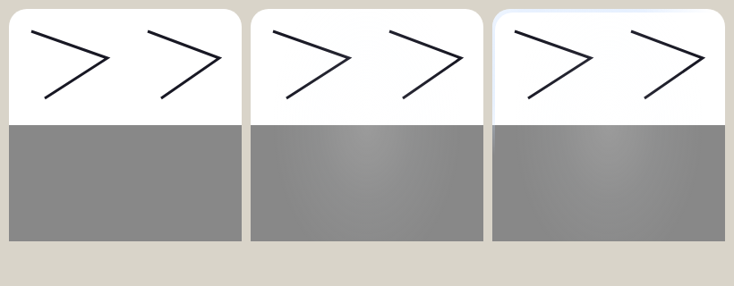

# Sticker laminate investigation and proposed correction

Date: October 12, 2026. Local source: `95fd6f2c0a968898cd8c6408bbe1f201e4b706ff`.

The laminate is still present, but its full-face reflection has too little contrast on white paper, and its edge highlight still animates without device movement. Phone tilt also starts a timed sweep that moves independently after the triggering reading. These are shared sticker material problems; Kyoto Seika Practice Mode selects a different foil, not a different laminate.

The correction should make a persistent, neutral reflection perceptible across the sticker's complete cut, including unpainted white interiors. Real phone motion should change its position continuously; a stationary phone should leave it stationary. Ink can influence the final appearance through compositing, but cannot determine the reflection's coverage or whether it exists.

This document records verified behavior and research. Product code is unchanged. The user confirmed viewing on an iPad and described a horizontal strip periodically disappearing. The exact ashtray sticker, viewing screen, browser/container, iPadOS version, and deployed build remain unidentified; the findings reproduce the shared renderer, rather than attributing every pixel in that specific sticker. The updated design is in `docs/superpowers/specs/2026-10-12-sticker-laminate.md`; renderer selection requires the material comparison described there.

## Confirmed causes

| Finding                                 | Source and consequence                                                                                                                                                                                                                                                  |
| --------------------------------------- | ----------------------------------------------------------------------------------------------------------------------------------------------------------------------------------------------------------------------------------------------------------------------- |
| Unattended specular movement            | `apps/frontend/src/stickers/live-resin.css:102` runs `live-resin-sway 11s ease-in-out infinite alternate`. Lines 121–131 move the highlight independently of sensor readings. A complete out-and-back cycle lasts 22 seconds.                                           |
| Very weak full-face reflection on white | `live-resin.css:51–59` uses white at alpha 0.16 and a pale-blue shoulder at alpha 0.055. Normal compositing produces no contrast for white over white; the shoulder has only tiny contrast. Gray and dark ink show a much larger change.                                |
| Strong reflection restricted to the rim | `live-resin.css:74–103` masks the strongest specular to the cut minus a copy shifted 1.1 by 1.6 `cqmin`. That represents an edge, rather than a complete reflective face.                                                                                               |
| Tilt triggers an independent sweep      | `apps/frontend/src/stickers/light.ts:261–280` adds a sweep after enough horizontal tilt, with a 1,400 ms cooldown. `resinSheen.ts:8–18` then translates white light across the sticker for 760 ms. Reversing or stopping the phone does not control that running sweep. |
| Additional bright surface sweeps        | `stick.ts:38–50` animates `.sticker-figure__sweep`; its gradient peaks at white alpha 0.82 in `sticker-figure.css:65–75`. Pickup, landing, replay completion, sealing completion, and receiving have other sweep triggers.                                              |
| Another unattended light in Shop        | `apps/frontend/src/shop/ShopScreen.css:360–417` circles two light values in 5-second alternating animations. `DESIGN.md:420` currently permits this exception. It must not run on iPad or phone; a timed fallback belongs only to devices without rotation input.       |

The live effect is already masked to the cut, including blank paper. `StickerFigure.tsx:91–94` supplies `--m` from `urls.mask`; `LiveResin` is always rendered at line 119, and `live-resin.css:12–20` uses that mask for each layer. Changing from an ink mask to a cut mask would not fix this problem: the cut mask is already correct.

The persistent light controller's frame loop is finite smoothing, not an idle oscillator. Its 45 ms write spacing, 0.02 deadband, 160 ms interpolation time constant, and 250 ms crease settlement are in `light.ts:33–50,215–250`. Keep input smoothing and tremor suppression; remove the independent animation sources.

The full-face white sweeps can turn dark ink visibly gray while barely changing white paper. The automatic edge sway alone does not prove the reported flash in a central ash-colored region. Attribution of that exact flash still requires inspecting its active animations, sensor readings, overlap, and replay state.

## iPad horizontal strip clarification

The reported symptom is now specifically a horizontal strip disappearing periodically on an iPad. There is no explicitly horizontal idle stripe in the inspected laminate code: the autonomous effect moves a radial edge highlight, and the timed sweeps are diagonal bands traveling across the face. A rotated sticker could change their apparent direction, but the description alone does not establish which layer is disappearing or whether printed artwork is affected.

Treat missing pixels separately from an unwanted highlight. On the affected iPad, keep its pose fixed and isolate the idle specular, timed sweep, crease/height response, and foil one at a time. First disable the autonomous animation with the layer retained, then hide the suspected layer; these distinguish motion from layering/clipping. Check whether the horizontal gap remains in the underlying print. Capture the complete cut at actual device scale, particularly around a repeated animation's direction changes, and retain the device/browser version with that evidence.

WebKit has documented animation-related clipping and missing tiled content. Bug 269284 describes disappearing content at transform animation iteration boundaries on large tiled layers; its reported animation direction and geometry differ from Croquis's alternating sway. Bug 239418 describes incorrect clipping with animation and absolutely positioned children, including an iPad report. These establish relevant failure modes to test, not a diagnosis of this iPad. Sources: https://bugs.webkit.org/show_bug.cgi?id=269284 and https://bugs.webkit.org/show_bug.cgi?id=239418.

The existing `apps/frontend/scripts/ipadSafari.ts` runs iPadOS Safari in a simulator and explicitly covers behavior desktop Playwright WebKit cannot show. Extend it with stationary laminate/missing-strip checks, but require review on the user's physical iPad too. The existing 260 px, 1× desktop browser probe did not reproduce a disappearing horizontal strip and does not substitute for that device check.

Regardless of strip attribution, the requested policy is settled: iPad and phone have no timed surface-light animation, including idle sway, Shop loops, or finite canned sweeps. Their persistent reflection responds to actual device tilt. A timed gloss wave is permitted only on devices without rotation input. Permission denial, a blocked API, absent readings, and backgrounding do not turn a phone or iPad into such a device.

## Browser reproduction

The probe uses the current `sticker-figure.css` and `live-resin.css`, a synthetic cut, black line art on white, and a gray lower half. It measures blank white pixels separately from black lines. It does not use a production sticker or alter the app.

| Measurement                                                                                    | Chromium                                          | WebKit          |
| ---------------------------------------------------------------------------------------------- | ------------------------------------------------- | --------------- |
| Persistent plane over blank white: maximum channel difference from uncoated print              | 2 / 255                                           | 1 / 255         |
| Persistent plane over blank white: mean maximum channel difference                             | 0.4333 / 255                                      | 0.3929 / 255    |
| Persistent plane over gray: maximum channel difference                                         | 18 / 255                                          | 18 / 255        |
| Persistent plane over gray: mean maximum channel difference                                    | 13.9340 / 255                                     | 14.0715 / 255   |
| Changed full-sticker pixels between sway clock positions 0 and 11,000 ms, without sensor input | 1,449 of 67,600                                   | 1,421 of 67,600 |
| Maximum channel difference from that unattended movement                                       | 15 / 255                                          | 15 / 255        |
| Material animation reported by the browser                                                     | `live-resin-sway`, 11,000 ms, infinite iterations | Same            |

The animation-clock comparison pauses and seeks the real CSS animation. It establishes time-dependent pixels without waiting for a physical phone or attributing a particular real sticker's flash. This fixture has no Kyoto Seika Practice Mode foil, crease, replay, or timed sweep, so those cannot cause its measured change.

The screenshot below shows uncoated print at left, the current persistent plane at center, and the full current live laminate at right. The reflection reads strongly on gray and barely on white.



Reproduction: `node docs/research/sticker-laminate/render-current.cjs`. Installed Chromium and WebKit are required. The probe has a 60-second deadline and saves its results to a temporary folder. The initial browser launch inside the filesystem sandbox failed with `bootstrap_check_in ... Permission denied (1100)`; the same local-only probe succeeded with approved browser execution outside that sandbox.

## How the behavior changed

| Commit                      | Change                                                                                                                   |
| --------------------------- | ------------------------------------------------------------------------------------------------------------------------ |
| `3abeb894`                  | Initial sticker board included autonomous `live-resin-sway`.                                                             |
| `f2bfc98c`, then `d758892d` | Board stickers' sway was disabled, then restored. It survives today.                                                     |
| `753aa9f3`                  | Foil's transient tilt glint became a persistent glint at the shared light position.                                      |
| `34b8d903`, October 9       | Replaced domed resin with thin laminate; removed the broad live lens/rim and baked pooling/tint.                         |
| `d6380033`                  | Removed the old specular/rim image assets throughout sealing, storage, and image types.                                  |
| `c1a6368e`, October 11      | Added the faint broad plane and optional reflection displaced by overlap height.                                         |
| `95fd6f2c`                  | Made shared light device-tilt-only and documented stillness without input; did not remove the independent laminate sway. |

Commit references:

- https://github.com/ethglobal-tokyo-2026/drawing-app/commit/d758892d8475120cdcade912a4546fb5e3f3bbbd
- https://github.com/ethglobal-tokyo-2026/drawing-app/commit/753aa9f37989fa6bd0ff37faab19dc20826f5954
- https://github.com/ethglobal-tokyo-2026/drawing-app/commit/34b8d903d707d65004e4cae2773320b1fa8ce35a
- https://github.com/ethglobal-tokyo-2026/drawing-app/commit/95fd6f2c0a968898cd8c6408bbe1f201e4b706ff

This was partly a deliberate visual change and partly an incomplete application of the newer motion policy. Restoring the previous resin dome wholesale would also restore its removed thickness and baked color modulation.

## Material research and renderer decision

### Real film and measured gloss

Avery Dennison describes clear and matte label films bonded with acrylic adhesive. Its digital-label table lists 0.75 mil clear BOPP and 1 mil matte BOPP, approximately 19 and 25 micrometers (PDF pages 6–7). These are real construction examples supporting a thin bonded coating; they do not identify Croquis's material. Source: https://label.averydennison.com/content/dam/averydennison/lpm-responsive/na/doc/product-overviews/product/overlaminates/br-overlaminates.pdf

3M's February 2026 bulletin lists 2 mil cast-vinyl overlaminates, about 51 micrometers, in both gloss and matte. Its 60-degree gloss values exceed 80 for gloss and fall below 30 for matte (page 1). Those values are calibrated gloss measurements, not reflection percentages or CSS alpha. NIST's gloss calibration describes source/view geometry and comparison with a reference standard. Sources: https://multimedia.3m.com/mws/media/1095382O/3m-scotchcal-gloss-overlaminate-3658g-matte-overlaminate-3660m.pdf and https://tsapps.nist.gov/publication/get_pdf.cfm?pub_id=841838

NIST's clear-coating experiments compare measured angular light scattering with calculations from measured surface topography. Changing roughness spans concentrated specular to diffuse scattering. These epoxy samples establish the roughness principle, not numeric sticker-film parameters (abstract and experimental setup, pages 1–2). Source: https://tsapps.nist.gov/publication/get_pdf.cfm?pub_id=860265

### Layering, view, and roughness

Google's Filament models clear coating as a separate dielectric specular layer with its own strength and roughness, over the base material. It also accounts for reduced light reaching the base. The clear coating therefore does not acquire its existence or coverage from the base's painted color. Source: https://google.github.io/filament/main/filament.html#materialsystem/clearcoatmodel

PBRT's coated-diffuse model is the closer starting point for a clear film over opaque printed paper. Its thin-dielectric model concerns a different geometry: a smooth material between equivalent exterior media. Do not assume a free film surrounded by air describes laminate bonded to paper through adhesive. Sources: https://www.pbr-book.org/4ed/Light_Transport_II_Volume_Rendering/Scattering_from_Layered_Materials and https://www.pbr-book.org/4ed/Reflection_Models/Dielectric_BSDF#ThinDielectricBSDF

W3C's compositing equations explain the present contrast failure: over an opaque backdrop, normal compositing reduces to `output = alpha * reflection + (1 - alpha) * print`. If both reflection and print are white, the result stays white. Source: https://www.w3.org/TR/compositing-1/#simplealphacompositing

The earlier recommendation to select masked CSS immediately was premature. A neutral reflected environment may be approximated with CSS, but adding a darker shoulder alone only establishes contrast. It does not establish correct reflectance, view dependence, roughness, or crease response. Compare a physically derived reference and a cheaper approximation using the same environment, artwork, cut, geometry, and poses before selecting the production renderer. Full-face material coverage is a requirement; keeping the present radial layers is not.

Gloss and matte should differ primarily through surface roughness: gloss preserves more distinct reflected shapes, while matte spreads and softens them. A broader lobe can have a lower peak without eliminating the coating or simply lowering its total reflection strength. Matte must not merely hide gloss, desaturate the print, or add white fog. Existing stickers remain gloss; matte is currently only a coming-soon Shop preview, as `PRODUCT.md:43,55` specifies.

OpenPBR separates coat coverage, roughness, refractive index, and transmission color from the substrate. Surface reflection of a clear dielectric is not tinted by the underlying ink. Its energy-preserving tests also show why white paper need not exhibit a pattern under uniform white illumination. For Croquis, a structured neutral environment and a declared virtual viewing geometry must make the coating legible at intended board/detail poses. Do not promise a bright highlight at every pixel or claim a gray stripe is physically inevitable. Source: https://academysoftwarefoundation.github.io/OpenPBR/

The existing height-mask duplicate shifts a reflection by fixed offsets (`live-resin.css:67–68`). This is an approximation, not a demonstrated surface model. A constant raised level has the same surface normal as the lower flat level; the changing slope through the crease changes reflection direction. Review a controlled ramp against a normal-based reference before retaining or replacing this behavior.

The current height PNG cannot be treated directly as geometric height: `crease.ts:318` encodes alpha as `h / (h + 1)` multiplied by silhouette coverage. Differentiating that alpha introduces nonlinear slopes and false silhouette edges. The worker still has the draped floating-point field before that encoding. Its existing `gx`/`gy` divide by `unitStep.slope` for visual tone, so those are not physical normal components either. Derive new normals from raw field differences, spatial distance, and an explicit height-to-distance scale rather than print brightness or masked alpha. A raised flat region keeps its planar normal; legitimate camera/source parallax remains possible.

The print itself is display-referred RGB with some fixed baked appearance, not measured diffuse albedo. A linear-light renderer is still a calibrated visual approximation when fed those pixels. Preserve the uncoated appearance and inspect fixed material separately; do not call it an exact physical reconstruction.

Khronos's clear-coat extension is a useful implementation precedent for separate coat strength, roughness, and normals, while explicitly listing simplified interlayer/refraction behavior. It is not a requirement to use glTF. Source: https://github.com/KhronosGroup/glTF/blob/main/extensions/2.0/Khronos/KHR_materials_clearcoat/README.md

Three approaches were considered:

1. **Remove idle movement and strengthen the existing white gradient.** Smallest change, but no amount of pure-white light creates contrast over pure-white paper. This does not satisfy the requirement.
2. **Projected environment with an inexpensive 2D coat approximation. Candidate.** Lower integration cost, but must prove reflection direction, roughness distinction, white-paper appearance, and ramp behavior against a shared optical reference. Plain CSS source-over is not linear-light transport.
3. **A dielectric coating renderer using surface normals and a reflected environment. Candidate/reference.** More direct control of angle-dependent reflection and roughness; requires measured board cost and rendering-resource recovery on iPad. GPU rendering is neither selected nor ruled out before that evidence.

A precomputed reflection atlas indexed by orientation/roughness is another option if the first two cannot meet device cost. It adds interpolation, memory, and ramp-geometry constraints; qualify those before treating it as a simpler replacement.

Detailed optical requirements and candidate qualification are in `docs/superpowers/specs/2026-10-12-sticker-laminate.md`. Pixel contrast checks will preserve a reviewed appearance; they cannot select the material or prove physical accuracy by themselves.

## Motion and coordinate requirements

- Remove `live-resin-sway` and Shop's separate light loop.
- Remove both event-triggered canned sweep overlays and their callers. This includes tilt, pickup/drop, receiving reveal, sealing's final landing, and replay completion. Preserve sticker movement, packaging/unpackaging, and the laminate application ceremony; those actions do not justify an independent traveling light after the action. The no-rotation timed fallback is a separate, centrally gated behavior, not permission to retain these triggers.
- On iPad and phone, keep device tilt as the only input for changing material light. Mouse, pen, and finger interactions remain ignored, consistent with the latest product decision.
- Permit the timed gloss wave only when the device has been classified as lacking rotation input. Browser interface presence does not prove working hardware, and the web has no general sensor-discovery API. Unknown capability stays static; do not infer no rotation from a timeout. Source: https://www.w3.org/TR/generic-sensor/#a-note-on-feature-detection-of-hardware-features
- A stopped phone holds its final reflection after finite smoothing. Missing or denied sensor access produces a still reflection, not an animated substitute.
- Initial/newly mounted material uses the same held light as material already on screen. Within the running document, ordinary screen changes and backgrounding retain the last published light. Before the first usable sensor reading, every material uses the common static top-left fallback.
- Stop pending light work when no sticker screen holds it, on backgrounding, and on reduced-motion activation. Reduced motion freezes the last published light, or the common fallback if no reading exists. Disabling reduced motion or resuming the document keeps that position until a usable reading on rotation devices. An eligible timed fallback pauses its phase rather than restarting a flash.
- Verify screen orientation and sticker rotation. `light.ts:71–79` currently omits screen orientation; W3C says device axes retain their standard orientation when the display rotates. `StickerFigure` passes `turn` to foil but not `LiveResin`, so the same light displacement is applied in each sticker's local axes. These concerns require controlled coordinate tests and portrait/landscape device review, separate from the established idle cause. Source: https://www.w3.org/TR/orientation-event/#device-orientation
- Verify actual orientation delivery after the existing iOS permission prompt. The app currently requests `DeviceMotionEvent` permission and checks `devicemotion`; that is not direct evidence that usable `deviceorientation` readings reach this renderer. Do not add a second prompt without establishing a device failure. The standard defines separate request methods and secure/visible-document constraints: https://www.w3.org/TR/orientation-event/

## Surface triggers to remove

| Location                                            | Current trigger                                                                                                  |
| --------------------------------------------------- | ---------------------------------------------------------------------------------------------------------------- |
| `stickers/light.ts`, `stickers/resinSheen.ts`       | Tilt threshold starts a 760 ms sweep.                                                                            |
| `sticker-board/useBoardGestures.ts:549`             | Pickup starts a resin sweep.                                                                                     |
| `stickers/stick.ts:38–50`                           | Landing and drop start the brighter figure sweep; board arrival and detail/Explore return use this function too. |
| `sticker-creation/sealing/SealCeremony.tsx:265–268` | Final landing starts a 640 ms resin sweep.                                                                       |
| `sticker-board/timelapse/useTimelapse.ts:263–265`   | Replay completion starts a resin sweep.                                                                          |
| `receiving/receive-gift-dialog.css:106–133`         | Unpackaging starts a delayed figure sweep.                                                                       |
| `shop/ShopScreen.css:360–417`                       | Each preview supplies its own looping light.                                                                     |

Board pause rules in `StickerBoard.css:88–98` become obsolete when sway is deleted. `keepAnimations.ts` also preserves real transitions and other animations; remove only obsolete material behavior, not the entire animation preservation utility.

## Presentation coverage and limits

| Presentation                                                                             | Current behavior and planned treatment                                                                                                                                                                                                                                       |
| ---------------------------------------------------------------------------------------- | ---------------------------------------------------------------------------------------------------------------------------------------------------------------------------------------------------------------------------------------------------------------------------- |
| Own and other Sticker Boards, detail, lifted Explore sticker, revealed receiving sticker | Shared `StickerFigure` and live laminate; correct the shared renderer and verify each integration.                                                                                                                                                                           |
| Seal ceremony and sealed card                                                            | Separate use of `LiveResin`; adapt its references after removing sweeps and verify a consistent final material.                                                                                                                                                              |
| Shop                                                                                     | Shared figure plus preview-specific materials; remove the independent loop and use the same capability-gated light as exposed stickers. No Shop exception on iPad/phone.                                                                                                     |
| Sticker tray                                                                             | Image and foil, no live laminate (`traySheets.ts:203–230`). A correction to `LiveResin` does not add a reflection here. If this is the reported viewing screen, adding the shared laminate to exposed tray stickers is required before claiming the reported issue resolved. |
| Explore pile, giving picker, gift bag, notices, small thumbnails                         | Images without live laminate. They retain their still exported appearance in this proposed correction. Adding live material to all of them is broader than repairing the existing surface feature, with separate performance and gift-concealment consequences.              |

The tray's missing live laminate is an explicit unresolved scope detail, not evidence that changing shared CSS repairs it. Confirm the reported screen before execution and expand the plan if the user expects live laminate there. Frosted gift sleeves must continue concealing the sticker.

## Existing assets and permanent baked gloss

`stickerPasses.ts:109–144,303–316` still bakes a faint fixed white gloss into the sealed normal and sharp images. Live laminate then appears over that fixed image. Old domed PNGs have separate display WebPs corrected by `flattenDomedSeal.ts`; the correction raises modeled paper toward white and retains ink. Those transformations are static and cannot create periodic animation.

Keep immutable sealed PNGs, content hashes, chain metadata, and original artwork intact. A live correction needs no asset migration. The baked white-paper and no-darkening tests protect the sealed image and should remain while changing only live presentation.

Inspect an older domed sticker and a recent thin-laminate sticker during final material review. A conspicuous permanent second highlight is a release blocker for the physical-light requirement. If present, plan a distinct unlit display-image derivative with new immutable cache names, sharp-image handling, veiled-image handling, access checks, purge lists, bounded generation, and a preservation test for original hashes. Do not guess original ink from gray values or alter stored originals. Exact reconstruction from existing flattened/quantized images is not established by this investigation; it requires a separate asset design before changing that path.

## Existing checks and why they missed it

Current focused tests all pass: 53 frontend tests across six files, plus nine API image tests across two files. Passing these tests does not establish that the surface looks correct.

- `StickerFigure.test.tsx:44–67` checks crease/height structure, not visible laminate on white.
- `light.test.ts` checks light variables and currently expects tilt sweeps. Stable variables do not imply stable pixels when CSS has its own animation.
- `e2e/foil.e2e.ts:69–72` hides all siblings after the foil, including the sticker and laminate. It cannot detect the shared surface bug.
- `stickerPasses.test.ts:105–127` checks immutable white paper/no darkening, not live contrast.

Verification commands, all exit 0 with 120-second subprocess deadlines:

```text
pnpm --filter frontend test src/stickers/light.test.ts
24 tests passed

pnpm --filter frontend exec vitest run src/stickers/StickerFigure.test.tsx src/sticker-creation/sealing/stickerPasses.test.ts src/sticker-creation/sealing/cutSticker.test.ts src/sticker-creation/sealing/makeSticker.test.ts src/stickers/crease.test.ts
29 tests passed

pnpm --filter @drawing-app/api exec vitest run src/stickers/flattenDomedSeal.test.ts src/services/imageStore.test.ts
9 tests passed
```

## Completion criteria for the future fix

1. At rest, line art and blank white interiors show a clear laminate reflection; the cut alone determines its coverage.
2. On iPad/phone and unknown devices, no material pixels move as time advances with no input, including after one complete former 22-second cycle. Only devices without rotation input may run the timed gloss fallback.
3. Real tilt moves the same persistent reflection continuously; reversal reverses it, and stopping holds it. No threshold event launches a separate pass of light.
4. White, black line art, gray ash-like fills, saturated colors, and full-bleed art share the same reflection field. Resulting colors may differ; coverage and material settings do not.
5. Plain, holo, Kyoto Seika Practice Mode, and pink foil retain the correct distinction between the face's laminate and the foil band.
6. Raised/flat areas and rotated stickers agree on one light. New mounts, reorders, and sharp-image swaps do not flash to a default light.
7. On phones/iPads, denied/unavailable readings, background/foreground, and screen changes preserve a deliberate still state. Reduced motion freezes every material, including an eligible timed fallback. A missing reading never changes device classification.
8. Sealing, receiving, pickup/drop, and timelapse finish without adding a traveling surface flash. Their meaningful movement and reveal states still work.
9. The exact ashtray sticker and device are reviewed before reporting that specific issue fixed. Any image-only presentation or baked-image limitation is reported explicitly.

Design spec: `docs/superpowers/specs/2026-10-12-sticker-laminate.md`. Implementation plan: `docs/superpowers/plans/2026-10-12-sticker-laminate.md`. Both are proposed work, not a claim that the app is fixed or that a renderer has passed physical-device review.
